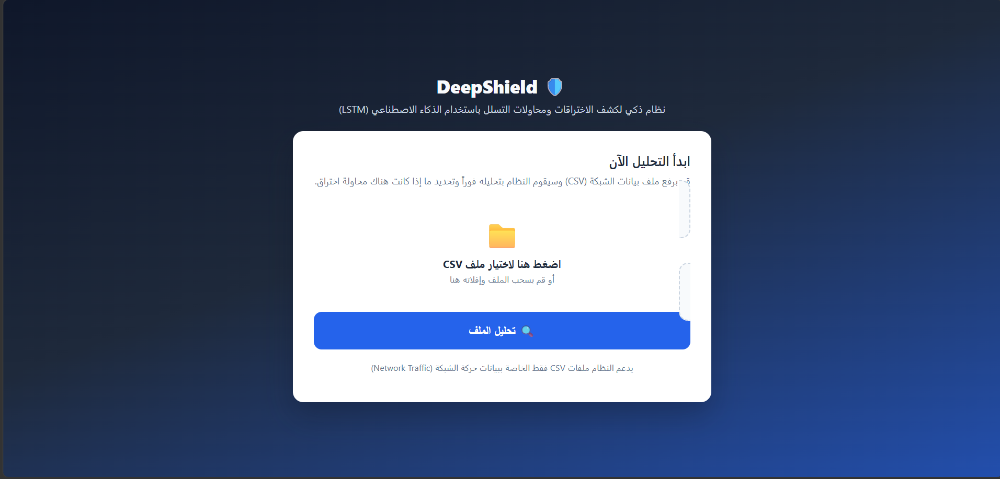
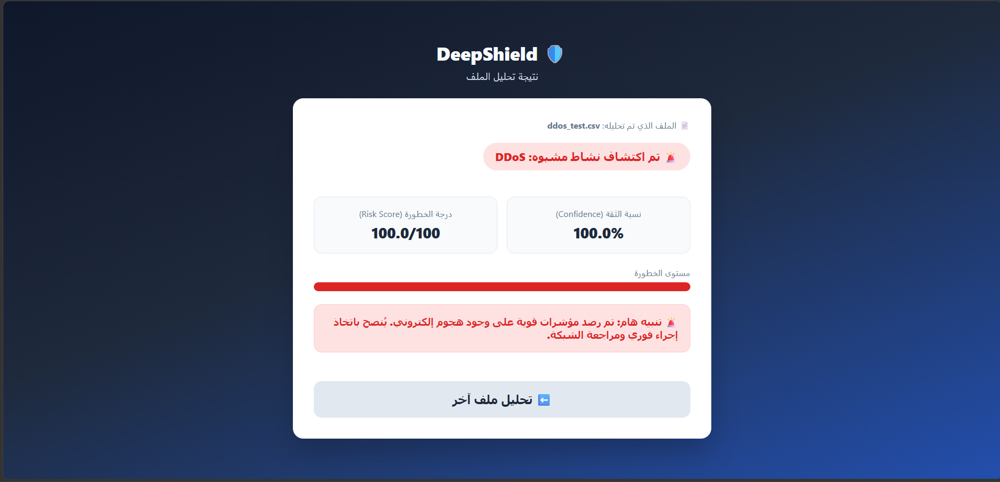
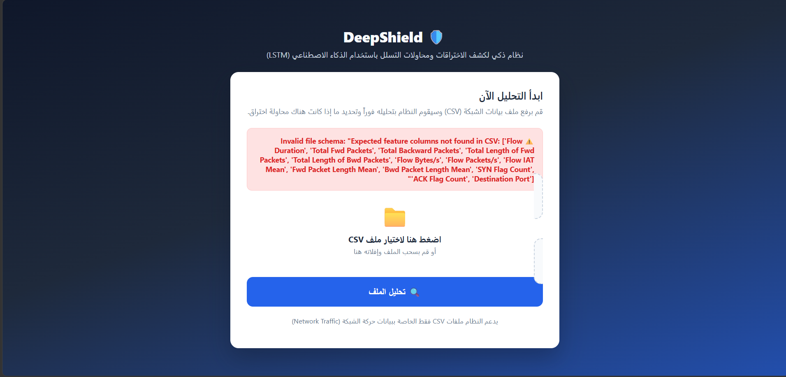

# Intrusion Detection LSTM Project (DeepShield)
## 📸 Screenshots

### Home Page


### Normal Traffic Result


### DDoS Detected


### Invalid File Validation


An end-to-end LSTM-based intrusion detection system trained on the
CICIDS2017 dataset, served through a Flask API.

> **Fixed for the official real dataset (MachineLearningCSV.zip):**
> the official CIC-IDS-2017 export only has 78 flow-feature columns +
> `Label` — it does **not** include `Source Port` or `Protocol`, which an
> earlier version of `src/config.py` referenced. That made
> `encoding.select_features()` raise `KeyError` on every real CSV. Those
> two columns have been removed from `NUMERIC_FEATURES` /
> `CATEGORICAL_FEATURES`. Separately, the `Web Attack` sub-type labels
> (`Web Attack ... Brute Force / XSS / Sql Injection`) use a separator
> byte that the official CSVs store in a form that always decodes to the
> Unicode replacement character (`�`) — no encoding recovers the original
> byte — so an exact-string match against `config.LABEL_MAP` silently
> classified every Web Attack row as `Other`. `encoding.map_single_label()`
> now matches those rows by the `"Web Attack"` prefix instead, which is
> encoding-independent and was verified against a real sample of the
> dataset (all correctly mapped to the `Web Attack` class). Both fixes
> were validated by running `src/cleaning.py` + the label-mapping logic
> against real subsets of `Monday-WorkingHours`,
> `Thursday-WorkingHours-Morning-WebAttacks`, and
> `Friday-WorkingHours-Afternoon-PortScan` — no missing columns, no
> leftover NaN/Inf, and correct label distributions.

## Project Structure

```
project/
├── data/               # place the REAL CICIDS2017 CSV files here (empty by default)
├── download_dataset.py  # optional: auto-downloads the official dataset into data/
├── src/
│   ├── config.py        # paths, hyperparameters, label map, feature list
│   ├── cleaning.py       # load + clean CSVs (whitespace, Inf, NaN, dupes)
│   ├── encoding.py       # label mapping, one-hot encoding, label encoding
│   ├── scaling.py        # MinMaxScaler (fit on train only)
│   ├── sequence_builder.py  # sliding-window sequence construction for LSTM
│   ├── pipeline.py       # orchestrates cleaning -> encoding -> split -> scaling -> sequencing
│   ├── model.py          # LSTM architecture
│   ├── train.py          # trains the model, evaluates, saves model.h5 + metrics
│   ├── predict.py        # inference on a new CSV using the saved model/scaler/encoder
│   └── app.py             # Flask API (POST /predict)
├── models/              # trained model.h5, scaler.joblib, label_encoder.joblib
├── outputs/             # confusion_matrix.png, metrics_report.txt
├── requirements.txt
└── README.md
```

## Getting the Real Dataset

This project trains **only** on the real CIC-IDS-2017 dataset (Canadian
Institute for Cybersecurity, University of New Brunswick). It ships with
no sample, synthetic, or dummy data — `data/` is empty until you add the
real CSVs, and `src/train.py` will refuse to run and print clear
instructions if it doesn't find them.

**Option A — automatic (needs internet access on the machine you run it on):**
```bash
python download_dataset.py
```
This downloads the official `MachineLearningCSV.zip` (~224 MB) directly
from the CIC's server and extracts the CSVs into `data/` for you.

**Option B — manual:**
1. Official dataset page: https://www.unb.ca/cic/datasets/ids-2017.html
2. Direct download: http://205.174.165.80/CICDataset/CIC-IDS-2017/Dataset/CIC-IDS-2017/CSVs/MachineLearningCSV.zip
3. Extract the zip and copy every `.csv` file into `data/`.

## Setup

1. **Create a virtual environment** (recommended):
   ```bash
   python -m venv venv
   source venv/bin/activate        # Windows: venv\Scripts\activate
   ```

2. **Install dependencies**:
   ```bash
   pip install -r requirements.txt
   ```

3. **Add the real dataset**: run `python download_dataset.py` (needs
   internet access), or manually place the CICIDS2017 CSV files (e.g.
   `Monday-WorkingHours.pcap_ISCX.csv`, `Tuesday-WorkingHours.pcap_ISCX.csv`, etc.)
   into the `data/` folder — see "Getting the Real Dataset" above.

   Every CSV in `data/` is validated individually before being merged:
   files that are empty, corrupted, missing a `Label` column, too small
   to be a real daily capture, or whose filename suggests sample/dummy
   data are skipped (with a printed reason) rather than silently trained
   on. `src/train.py` prints how many files loaded successfully, the
   final row/feature counts, and the label distribution before training
   starts.

   > **Before training**, open `src/config.py` and confirm that
   > `LABEL_MAP` and `SELECTED_FEATURES` match the exact column headers
   > in your copy of the dataset — CICIDS2017 exports vary slightly
   > between sources (spacing, dashes in "Web Attack" labels, etc.).

## Training

```bash
python -m src.train
```

This will:
- Load and clean every CSV in `data/`
- Encode labels into 6 classes: `Normal`, `DDoS`, `PortScan`, `Brute Force`, `Web Attack`, `Other`
- Split into train/validation/test sets (stratified)
- Fit `MinMaxScaler` on the training set only, then scale all sets
- Build sliding-window sequences for the LSTM
- Train the LSTM model with early stopping and learning-rate reduction
- Save the trained model to `models/model.h5`
- Save the fitted scaler and label encoder to `models/`
- Evaluate on the test set and save:
  - `outputs/metrics_report.txt` (accuracy, precision, recall, F1, classification report)
  - `outputs/confusion_matrix.png`

## Running Inference (standalone)

```bash
python -m src.predict path/to/new_traffic.csv
```

Prints the predicted class, confidence, and computed risk score (0-100).

## Running the API

```bash
python -m src.app
```

Then, in another terminal:

```bash
curl -X POST http://localhost:5000/predict \
  -F "file=@path/to/new_traffic.csv"
```

Example response:
```json
{
  "predicted_class": "DDoS",
  "confidence": 0.9732,
  "risk_score": 97.32,
  "should_alert": true
}
```

`should_alert` is `true` when `risk_score` exceeds the threshold set in
`config.RISK_ALERT_THRESHOLD` (default: 90) — this is the hook point for
wiring up Email/Telegram alerting or Firebase storage in the next
development iteration.

## Verification & Validation (V&V)

Suggested test cases to run and record for your report:

| Test Case                  | Expected Result                                  |
|-----------------------------|---------------------------------------------------|
| Normal traffic CSV           | Classified as `Normal`, low risk score            |
| DDoS traffic CSV             | Classified as `DDoS`, high risk score              |
| PortScan traffic CSV          | Correctly detected                                  |
| Empty CSV                    | `/predict` returns 400 with a validation error      |
| CSV missing required columns  | `/predict` returns 400 with a schema error          |
| Very small CSV (< timesteps)  | Handled via window padding, still returns a prediction |

## Notes on Design Decisions

- **Scaler leakage**: `MinMaxScaler` is fit only on the training split,
  never on validation/test or the full dataset, to avoid inflating
  reported accuracy.
- **Sequence construction**: CICIDS2017 rows are pre-aggregated flows, not
  raw packets, so "sequence" means a sliding window of consecutive flows
  (`config.TIMESTEPS`, default 10). The window's label is the label of its
  last flow.
- **Unmapped labels**: any raw CICIDS2017 label not explicitly listed in
  `config.LABEL_MAP` falls into the `Other` class rather than being
  dropped, so rare attack types stay in the dataset.
- **Model persistence**: the trained model, scaler, label encoder, AND the
  exact one-hot-encoded feature column list are all saved to disk
  (`models/feature_columns.joblib`) so that training and inference always
  agree — this is what makes `src/predict.py` and `src/app.py` produce
  consistent results with the trained model.
- **Feature column alignment (bug fix)**: a fresh CSV uploaded for
  prediction may only contain a subset of `Protocol` values seen during
  training (e.g. only TCP, when training saw TCP/UDP/ICMP). Since
  `Protocol` is one-hot encoded, this produces a different number of
  columns and previously crashed `scaler.transform()` with a 500 error.
  `encoding.align_features_to_training_columns()` reindexes new data to
  the exact training-time columns (filling missing ones with 0) before
  scaling, fixing this.
- **Debug error detail**: `app.py` has `DEBUG_ERRORS = True` — unexpected
  500 errors return the real exception type/message in the JSON response
  and always print a full traceback to the server console, regardless of
  Flask's debug flag. Set `DEBUG_ERRORS = False` before any real
  deployment so internals aren't exposed to callers.
